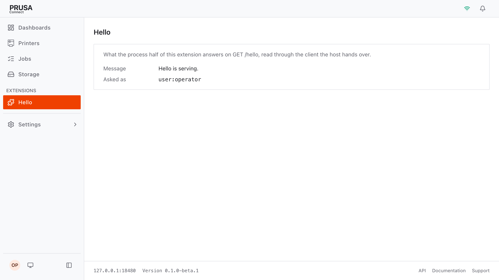
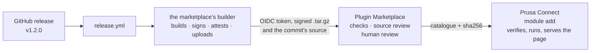

# Prusa Connect extension example

A minimal Prusa Connect extension with both halves, published to the
[Prusa Plugin Marketplace](https://plugin-marketplace.prusa3d.com/connect) from GitHub Actions with
[prusa-connect-marketplace-publish](https://github.com/prusa3d/prusa-connect-marketplace-publish).
Use it as a template: change the name, the module path, the licence and the code, and keep the
release pipeline.

- **The process** (`main.go`): a program Prusa Connect starts for the extension. It speaks the
  wire protocol over stdio and serves one route, `GET /hello`. It is Go on the Prusa Connect SDK.
- **The browser bundle** (`ui/`): a Svelte page on the Prusa Connect component library, with an
  entry in the sidebar, that the host loads into the Connect web app. It reads `GET /hello` through
  a typed client generated from `openapi.json`.





Its module path is `github.com/prusa3d/prusa-connect-extension-example`. The host and the
marketplace derive the extension id from it, `com.github.aux.prusa3d.prusa-connect-extension-example`;
you never write the id yourself.

| path | purpose |
| --- | --- |
| `module.yaml` | the manifest: name, version, licence, platforms, settings, the requests an operator approves, and the `ui` block with what the bundle may register |
| `main.go`, `faults.go`, `main_test.go` | the process: handshake, lifecycle, settings, the route, every error code, tests |
| `openapi.json` | the route, relative to the mount |
| `ui/src/` | the bundle's entry (`index.ts`), the page (`page.svelte`), the call to the process (`hello.ts`), its styles and its texts |
| `client/` | the typed client for the route, generated from `openapi.json` by `make client` |
| `CHANGELOG.md` | what an operator sees change; the top heading is the `version` in `module.yaml` |
| `LICENSE` | the licence the example is under, the same one `license` in `module.yaml` names |
| `Makefile` | `make check`, `make client`, `make release`, `make install` |
| `scripts/platforms.sh` | the platforms `module.yaml` declares, which `make release` builds |
| `.github/workflows/` | `ci.yml` (checks and the marketplace's dry run on every push) and `release.yml` (publish) |

## Make it yours

1. Create a repository from this template.
2. Set your module path in `go.mod` (`module github.com/<you>/<repo>`). It is the extension's
   identity: the id is derived from it, and it never changes after the first release.
3. In `module.yaml`, rename `name:` and write your own `title`, `summary` and `codeowner`. Then fix
   the namespace in `faults.go` and the locale keys; `grep -rn hello` finds every place.
4. Set `license:` in `module.yaml` to the licence you release under, and put its text in `LICENSE`.
   The key is required: free text of at most 200 characters, an SPDX identifier such as `MIT` or
   `Apache-2.0` where one fits. Operators read it on the marketplace before they install, and a
   release without it is refused.
5. Change the route in `main.go` and `openapi.json`, then run `make client` and commit what it
   writes.
6. Ask in `module.yaml` for exactly what the extension uses (`permissions`, `needs`, …) and set
   `platforms:` to what you ship.
7. Do the one-time setup under [Publish](#publish), then publish a GitHub release.

## Build

Needs Go (the version in `go.mod`), Node 22.12+ and pnpm (`corepack enable`).

```bash
make check     # Go vet and tests, the client is current, the UI's lint, types and build
make release   # release/: module.yaml, ui/, one binary per platform in module.yaml (to try it)
make install   # installs release/ into bin/try with Prusa Connect's own `module add`
```

`make install` prints the command that starts Prusa Connect with the extension installed. To work
on the page with a dev server in front of it, run this from the Prusa Connect checkout the build
uses:

```bash
cd .core && go run ./cmd/new-module -start demo -dir ..
```

It starts the demo on a free port with this extension installed, and prints the address to open
and the account to sign in with. Ctrl+C stops everything it started.

> [!NOTE]
> Until the Prusa Connect SDK and the `@prusa` npm packages are published, both halves build
> against a checkout of [Prusa Connect](https://github.com/prusa3d/prusa-connect) at `CORE_REF`
> (Makefile), which `make` clones into `.core/`. `go.mod` points there with a `replace` line;
> delete it once the SDK is published. To build against a newer core, `rm -rf .core` and raise
> `CORE_REF`, and raise `require.core` in `module.yaml` with it.

## Publish

1. Raise `version` in `module.yaml` and add its heading to `CHANGELOG.md`.
2. Publish a GitHub release tagged `v<version>`. A pre-release goes to the beta channel; the
   release notes become the changelog on the marketplace.
3. `release.yml` calls the marketplace's builder
   ([prusa3d/prusa-connect-marketplace-publish](https://github.com/prusa3d/prusa-connect-marketplace-publish)),
   which builds every platform and the bundle from this commit, signs the release, records a build
   provenance attestation and uploads it with the commit's source. The marketplace checks the
   release and reviews the source, and a person at Prusa reviews it before operators can install
   it. `make release` is not part of this; it is for
   trying the extension yourself.

One-time setup, in this repository and in the marketplace's author console:

| what | where |
| --- | --- |
| the repository is public: GitHub records the attestation only for a public repository | repository settings → General |
| an author profile and the public half of your signing key | marketplace → Become an author, Signing keys |
| an environment named `release` that only `v*` tags may deploy to, with required reviewers | repository settings → Environments |
| `PRUSA_CONNECT_EXTENSION_SIGNING_KEY`: the RSA private key whose public half is registered | secret of that environment |
| a trusted publisher: the extension id, `owner/repository`, `release.yml` and the environment | marketplace author console → Trusted publishing |

The marketplace's documentation walks through each step:
[publishing an extension from GitHub Actions](https://plugin-marketplace.prusa3d.com/docs/connect/github-actions).

## License

The example is under the MIT License (`LICENSE`), so you may build on it freely. Your extension
states its own licence in `module.yaml`.

## Iterating

`-start` runs the module's own dev server, `pnpm dev` in `ui/`. Open the
address it prints, not the core's. The page is the core's app and this module
is served from `src/`, so an edit to a component shows up without a reload.
Run by hand, `pnpm dev` reads the core's address from `PCL_CORE_URL`,
`http://localhost:8080` by default.

Install again after changing `module.yaml`: the core reads what a module
contributes when it is installed.

## Configuration

`options:` in `module.yaml` names every setting this module reads, each with its
type, its default and one sentence saying what it controls. Nothing here reads
an environment variable, so that list is the whole of what an operator can set.

The host applies the defaults, writes the instance's `config:` block over them
key by key, and sends the result on `plugin.configure` before the first request
arrives. A key the manifest does not name is refused before the process starts.

```yaml
resources:
  sink:
    hello:
      config:
        message: Ready.
```

## Permissions

This module declares no `permissions:`, because it acts only for the person the
host authorized and does nothing of its own: no poll, no sync loop, no
background work. The host takes `view_resource` on the instance before a read
and `operate_resource` before a write, and `openapi.json` states that on each
operation.

A module that does work with nobody behind it adds `permissions:` to
`module.yaml`, one line per permission saying what it lets the module do. An
operator reads that list before `module add -approve` writes it into the
declaration and grants the module what the list names. The install prints every
grant it wrote, and `module remove` takes them back.

## Errors

When the module cannot do what a request asks, it answers with an error. The
error has a `code` and a `title` in English. Every code of this module starts
with `com.github.aux.prusa3d.prusa-connect-extension-example`.

A program that calls the module should check the `code`. The title is for
people. You can change the wording of a title without breaking a caller.

`faults.go` lists every code, with what went wrong and what the caller can do
about it. Add a new code in that file. The page in the browser shows an error
through `describeFault`, which looks up the translation for the code and shows
the English title when it finds none.

## What the pieces are

The bundle's build writes `ui/dist`, and that directory is already the release
layout: `module.yaml` at its root and the entry at `ui/index.js`, with the
binary `hello_<GOOS>_<GOARCH>` beside them. `-from ui/dist` is what the install
reads. A `checksums.txt` is optional and verified when it is there; a release
you just built has nothing to prove against.

```bash
prusa-connect module add github.com/prusa3d/prusa-connect-extension-example@1.0.0 -from ui/dist
prusa-connect module list
prusa-connect module remove github.com/prusa3d/prusa-connect-extension-example
```

Without `-approve` the declaration is written switched off, and the command
prints what the module asked for so an operator can read it first.

## The ceiling

`contributes` in `module.yaml` is the whole of what this bundle may register.
A `host.register` call the block does not declare throws, and the host drops
this module whole. The generator wrote both sides from one answer:

- `pages: hello` ← `host.register.page('hello', Page)`

Add one to the manifest and the other to the entry, or neither.

## Styling

`ui/src/styles.css` carries four directives and only the third emits anything.
They let this module name any Tailwind utility the library's theme defines,
without shipping Tailwind's preflight into the host page. The page behind them
is `styling-a-module` in the core's documentation.

## Texts

Every text a person reads is a key in `ui/src/locales/en.json`, read with
`host.t('<key>')`. The host merges that file under this module's namespace, so
a key here may be one the core already names. Copy the file to `<tag>.json` to
translate it.

## The page calls the process

`ui/src/hello.ts` reads `GET /hello` through `client/`, a typed client generated from
`openapi.json`, bound onto the client the host hands the bundle:

```ts
const routes = bind(host.client);
const hello = await routes.readHello({}, host.signal);
```

There is no `fetch`, URL or token in a module's browser half: the call carries the session the
person already has, and the host decides whether they may make it. After a change to
`openapi.json`, run `make client` and commit what it writes; `make check` fails until you do.

## Troubleshooting

| what you see | what it means |
| --- | --- |
| `module add` refuses the release | `ui/dist` is not the release layout. `module.yaml` sits at its root and the entry at `ui/index.js` |
| the module is listed and switched off | `module add` ran without `-approve`. Read what it printed, then switch the instance on |
| the sidebar entry is missing | the app refused the bundle. Open the browser console: a registration `contributes` does not declare is refused there by name |
| a screen shows a key instead of a sentence | the key is missing from `ui/src/locales/en.json` |
| a response carries a code and an English sentence | the process refused the request. Look the code up in `faults.go` |
| a change does not show | the install was not run again. Every change is a new install |
| the publish run or the marketplace says `module.yaml has no license` | add `license:` to `module.yaml`, such as `license: MIT` |
| the publish run says `Failed to persist attestation: Feature not available` | the repository is private; the attestation needs a public one |
| the marketplace says a field `holds U+…, a control or invisible character` | write `license`, `title`, `summary` and egress `why` and `sends` as plain text |
